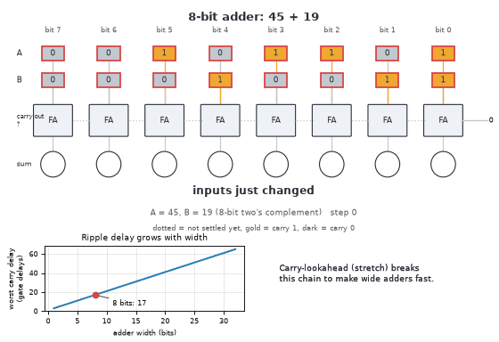
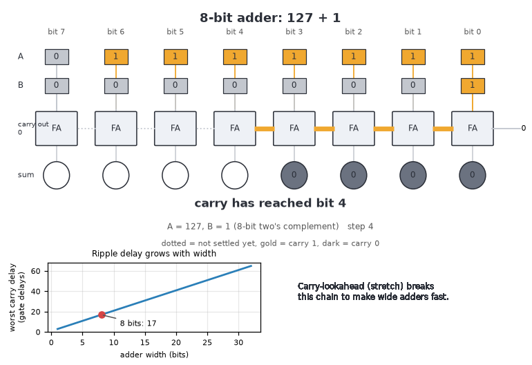
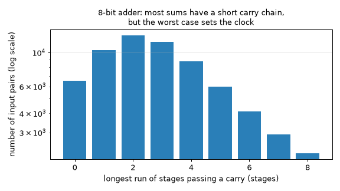
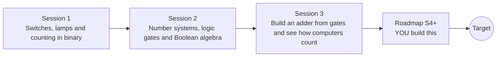

# openbinary

[](https://github.com/KrunalPanchal1995/openbinary/actions/workflows/ci.yml)   [](https://colab.research.google.com/github/KrunalPanchal1995/openbinary/blob/main/sessions/session-01/lesson.ipynb) [](https://krunalpanchal1995.github.io/openbinary/)

**Build an adder from logic gates and see how computers count, in three sessions.**

openbinary teaches how computers hold numbers as on/off switches and how a few logic gates add, subtract and decide, using only Python and a browser.

- **Start from a switch.** Session 1 needs only the idea of on and off; place value is explained from scratch.
- **See it light up.** Every session ships a slider app that runs in the browser, with labelled graphs.
- **Prove it by trying everything.** Each checkpoint tests circuits on every input and prints PASS or FAIL against Python.
- **Build the missing half.** The repo stops at Session 3 on purpose; the roadmap shows the path to the Target.

[Target](#the-target) · [Who is this for](#who-is-this-for) · [Quick start](#quick-start) · [Sessions](#sessions) · [Roadmap](#roadmap) · [Contribute](#contribute) · [Explainer PDF](docs/explainer.pdf)

> **This repo is incomplete on purpose.** Sessions 1 to 3 are here and fully working. The finished Target below is a preview of what the community can build next. We show you the path, not the code. Sessions 4 and up are yours.

## The Target

An 8-bit adder runs three sums. Switches flip, and the carry ripples one full adder at a time, lighting its wire as it goes: 45 + 19 = 64 sends a carry through six stages, 127 + 1 sends a carry through seven stages and raises the overflow flag (the answer wraps to -128), and -1 + 1 = 0 sends a carry through all eight stages. A chart shows how the worst-case delay grows with the number of bits (17 gate delays at 8 bits). Your goal over the coming sessions: build that adder yourself, then make it fast.



*Target: an 8-bit adder where the carry ripples through eight full adders*



*Target, one frame: carry wires lit part-way along the chain, with the delay chart*



*How long the carry chain is for every pair of 8-bit numbers: usually short, but the worst case sets the speed*

Try it live:

- [Math Visual Studio (open the Studio and explore the Atlas)](https://krunalpanchal1995.github.io/studio/)

How the Target was made is shown only as a path in [promo/roadmap.md](promo/roadmap.md).

## Who is this for
**secondary school to diploma / undergraduate (levels 3-5).** Topic area: Computer Science, Programming and Software.

Prerequisites:

- Whole-number arithmetic and the idea of place value in decimal numbers (school level).
- Python 3.10 or newer; if `python --version` works, you are ready. PRIMER.md explains the rest.
- No prior GitHub, electronics or programming-theory experience is needed.

New to Python? Read [PRIMER.md](PRIMER.md) first (10 minutes).

## Quick start

No installation knowledge needed. You need [Git](https://git-scm.com/downloads) and [Python 3.10+](https://www.python.org/downloads/) (Windows: tick "Add Python to PATH"). On Mac and Linux type `python3` wherever this page says `python`.

```bash
git clone https://github.com/KrunalPanchal1995/openbinary.git
cd openbinary
python start.py 1
```

`start.py` creates a private environment, installs what is needed and runs Session 1 with its checkpoint. Next: `python start.py 2`, `python start.py 3`, or `python start.py test` to check everything. Only a checkpoint: `python start.py check 1`.

Five lines turn the idea of Session 1 and Session 3 into results (they work as they are): Save it as `try.py` and run it with `python start.py run try.py` (this uses the private environment, where NumPy is installed):

```python
import numpy as np
bits = np.array([1, 1, 0, 1])                  # four switches, biggest place first
print(bits @ np.array([8, 4, 2, 1]))           # -> 13
a, b = 1, 1
print('sum', a ^ b, 'carry', a & b)            # half adder: 1 + 1 = binary 10
```

Every session also opens in your browser with sliders (no install): [live apps](https://krunalpanchal1995.github.io/openbinary/). Or use the Colab badge above for the notebook.

## Sessions

| # | Session | Model level | Time | Live app |
|---|---|---|---|---|
| 1 | [Switches, lamps and counting in binary](sessions/session-01/README.md) | Level 1: conceptual interactive model | 60 min | [open](https://krunalpanchal1995.github.io/openbinary/session-01/) |
| 2 | [Number systems, logic gates and Boolean algebra](sessions/session-02/README.md) | Level 2: mathematical engineering model | 75 min | [open](https://krunalpanchal1995.github.io/openbinary/session-02/) |
| 3 | [Build an adder from gates and see how computers count](sessions/session-03/README.md) | Level 3: simulation and validation | 90 min | [open](https://krunalpanchal1995.github.io/openbinary/session-03/) |

Each session follows the same six steps: A real-world problem, B concept and theory, C visual explanation, D interactive simulation, E worked example and experiment, F assessment and design challenge. Each ends with `checkpoint.py`, which prints `PASS` or `FAIL` against reference numbers. Session 3 also contains the real-world mini-project: **Build and test an 8-bit adder-subtractor**.

## Architecture



| Folder or file | What is inside |
|---|---|
| `sessions/` | three sessions: README (A-F), `lesson.py`, notebook, live app, exercises, activity sheet, checkpoint |
| `promo/` | the Target: media, live links, and the roadmap (path only) |
| `docs/` | `explainer.tex` and the built `explainer.pdf` |
| `tests/` | runs every lesson and checkpoint headless |
| `start.py` | one command to set up and run anything |
| `QUALITY.md`, `RUBRIC.md` | the quality checklist and the scoring rubric |
| `.github/` | CI, PDF build, Pages deploy, issue and PR templates |

## Roadmap

| Milestone | What you will build | Difficulty |
|---|---|---|
| Session 4: A carry-lookahead adder | A 16-bit adder built in the simulator whose carries do not ripple. | advanced |
| Session 5: A 4-bit multiplier | A 4 x 4 multiplier made of gates with an 8-bit product. | intermediate |
| Session 6: A saturating adder | An 8-bit adder-subtractor that returns the nearest extreme on overflow. | intermediate |
| Session 7: A counter that remembers | A 4-bit counter driven by clock ticks. | advanced |
| Session 8: An ALU with flags and a decoder | An 8-bit ALU with four operations and flags, and a decoder lighting the right segments for each digit. | advanced |

Full detail with a checkpoint per milestone: [promo/roadmap.md](promo/roadmap.md).

## Contribute
New to GitHub? Read [CONTRIBUTING.md](CONTRIBUTING.md); it starts from zero. Pick an issue labelled `good first issue`. Translations into Hindi, Telugu, Tamil and Malayalam are welcome.

<details>
<summary>Development</summary>

```bash
python start.py test        # runs every lesson and checkpoint
```
Lessons use `# %%` cell markers so they open as notebooks in VS Code. See [QUALITY.md](QUALITY.md) for the standard every session meets.
</details>

## License
MIT. See [LICENSE](LICENSE). Media in `promo/media` is (c) Krunal Panchal, CC BY 4.0.

## Acknowledgments
Part of the [PAN IIT OSS](https://hellofoss.tech-iitb.org/projects) open-source teaching collection, modelled on the structure of [openspline](https://github.com/openspline/openspline). Built on ideas from the Math Visual Studio at https://krunalpanchal1995.github.io/studio/.
