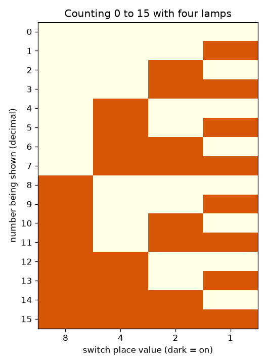
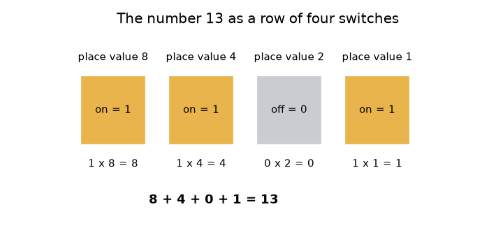

# Session 1: Switches, lamps and counting in binary

*Level 1 (conceptual interactive model) · about 60 minutes · openbinary*

> This is a simplified educational model. It is not a validated design tool and must not be used for real structures, electrical installations, vehicles, industrial processes or medical decisions.

**Prerequisites**

- Whole numbers and place value in decimal (ones, tens, hundreds).
- You have read PRIMER.md and run `python start.py 1` once.

**Learning objectives.** After this session you can:

- Explain how a row of on/off switches can store a number.
- Convert a pattern of switches to a decimal number using place values, and back.
- Count from 0 to 15 on four switches and describe the pattern.
- Say how many numbers n switches can hold, and what happens when a count goes past the largest.

## A. Real-world problem
A light switch is on or off, nothing in between. A computer is built from an enormous number of such switches, yet it stores photos, songs and bank balances. How can something that only knows 'on' and 'off' hold a number like 13? This session answers that with four lamps and four switches. It is a simplified educational model of how whole numbers are stored; real computers use the same idea with many more bits.

## B. Concept and theory
In the decimal number 345 each digit is worth ten times the digit to its right: 3 hundreds, 4 tens, 5 ones. Binary does the same with the number 2. A *bit* is one digit that is 0 (switch off) or 1 (switch on). With four bits the places are worth 8, 4, 2 and 1 from left to right. The number is the sum of the place values of the switches that are on. So 1101 means 8 + 4 + 0 + 1 = 13. Every switch you add doubles the number of patterns, because each old pattern can now come with the new switch off or on. Four switches make 16 patterns, which count from 0 (all off) to 15 (all on). Adding one to 15 would need a fifth switch; with only four, the count wraps round to 0.

| Symbol | Meaning | Unit |
|---|---|---|
| b_k | state of switch number k: 0 (off) or 1 (on) | no unit (a bit) |
| 2^k | place value of switch k | no unit |
| n | number of switches (bits) | count |
| N | the whole number the switches show | no unit |

**Assumptions**

- Switches are ideal: always fully on or fully off.
- We store whole numbers from 0 upwards only (negative numbers come in Session 3).
- The leftmost switch is the biggest place value.

$$ N=\sum_{k=0}^{n-1} b_k\,2^{k} $$

$$ \text{number of patterns}=2^{n},\qquad \text{largest number}=2^{n}-1 $$

$$ 1101_2 = 1\cdot 8+1\cdot 4+0\cdot 2+1\cdot 1=13 $$

## C. Visual explanation
The first figure shows the number 13 as four switches with their place values 8, 4, 2 and 1: the lamps over the first, second and fourth switches are on, and the sum 8 + 4 + 0 + 1 = 13 is written underneath. The second figure is the whole counting table from 0 to 15, one row per number and one column per switch. Look down the right-hand column: it flips every row. The next column flips every two rows, then every four, then every eight, like the wheels of an odometer that only have the digits 0 and 1.

*Counting 0 to 15: one row per number, dark squares are lamps that are on.*

*The number 13 as four switches with place values 8, 4, 2, 1.*

## D. Interactive simulation
Run the lesson (`python start.py 1`), then open the live app: [Session 1: four switches and four lamps](https://krunalpanchal1995.github.io/openbinary/session-01/) (or `app.html` in this folder). Flip the four switch sliders and watch the lamps and the sum. Then open the graph view and see how many lamps are on for each number from 0 to 15.

**Challenge.** Show the number 13 on the lamps (pattern 1101).

## E. Worked example and experiment
**Problem.** What number do the switches 1101 show? Then show the number 12 as switches.

1. Write the place values over the switches: 8, 4, 2, 1.
2. Switches on are the first, second and fourth, so add 8 + 4 + 1 and add 0 for the third: 8 + 4 + 0 + 1 = 13.
3. For 12 take the biggest place value that fits: 8 fits (12 - 8 = 4), 4 fits (4 - 4 = 0), 2 and 1 do not.
4. So 12 is 8 + 4 = 1100 (first and second switch on).
5. Check: 8 + 4 + 0 + 0 = 12.

**Answer.** 1101 shows 13, and 12 is written 1100.

**Experiment.** Find four small objects (for example four coins) and decide that heads means on. Lay out 1101 and ask a friend to read the number; then ask them to show 9. Real switches are not perfect: a mechanical switch can flicker before it settles (this is called bounce), and a real lamp needs time to light. The model assumes each switch is instantly and cleanly 0 or 1.

## F. Assessment and design challenge
**Question type A: Conceptual.** Why does adding one more switch exactly double the number of different patterns?

Hint

Take every pattern you already had and ask how many ways the new switch can be set.

Step-by-step solution

Each old pattern can be combined with the new switch off or on, which gives two new patterns for every old one. Four switches make 16 patterns, five make 32. So n switches make 2^n patterns, and the largest number is 2^n - 1 because the counting starts at 0.

**Question type B: Numerical.** Read the switches 1011 as a decimal number, and write 12 as switches. Sanity check each result.

Hint

Use the place values 8, 4, 2, 1.

Step-by-step solution

1011 = 8 + 0 + 2 + 1 = 11. For 12: 8 + 4 = 12, so the pattern is 1100. Sanity check: 11 is below 15 (the largest on 4 switches) and 1100 sums back to 12.

**Question type C: Graph and simulation interpretation.** In the graph of lamps on against the number, how many numbers between 0 and 15 have exactly two lamps on? What is the highest point of the graph and where does it occur?

Hint

Count the dots at height 2, and look for the number with every switch on.

Step-by-step solution

Six numbers have exactly two lamps on: 3, 5, 6, 9, 10 and 12. The graph is highest (4 lamps) at 15, where every switch is on, and lowest (0 lamps) at 0. The counts at heights 0 to 4 are 1, 4, 6, 4, 1.

**Question type D: Design and optimisation challenge.** Design: a hall has 100 seats numbered from 0 to 99. A sign should show the seat number on lamps. What is the smallest number of lamps? Name one trade-off of using more lamps than that.

Hint

Find the smallest n with 2^n at least 100.

Step-by-step solution

6 lamps give only 64 patterns, which is not enough. 7 lamps give 128 patterns, which covers 0 to 99, so 7 lamps are enough and 7 is the smallest number. Using 8 or more lamps would cost more parts and more wiring while only wasting patterns; using fewer is impossible. Assumption: one lamp per bit and a fixed, known maximum seat number.

Score yourself with [RUBRIC.md](../../RUBRIC.md). Print the [activity sheet](activity_sheet.md) to work on paper.

## Common misconceptions
| Common misconception | What is actually true |
|---|---|
| Binary is a different kind of number. | It is the same number written another way. 1101 in binary and 13 in decimal are the same quantity. |
| The digit 2 exists in binary. | Binary digits are only 0 and 1; when a place would reach 2 you carry into the next place, just as 9 + 1 carries in decimal. |
| The leftmost switch is worth 1. | The leftmost is the biggest place (8 on four switches); the rightmost is worth 1. |
| Counting past the largest number makes a bigger number. | Four switches cannot show 16; the count wraps to 0000, exactly like a car odometer rolling over. |

## Glossary
- **bit**: one binary digit: 0 (off) or 1 (on)
- **binary**: the number system with only two digits, 0 and 1, and place values 1, 2, 4, 8, ...
- **place value**: how much a digit is worth because of where it sits
- **pattern**: a particular setting of all the switches
- **wrap around**: going past the largest number and coming back to 0

## Finish
1. Do the three coding tasks in [exercises.md](exercises.md).
2. Run `python start.py 1` again after your changes. It ends with the checkpoint; when it prints `PASS`, you are done. (Checkpoint only: `python start.py check 1`.)

Next: [Session 2](../session-02/README.md)
