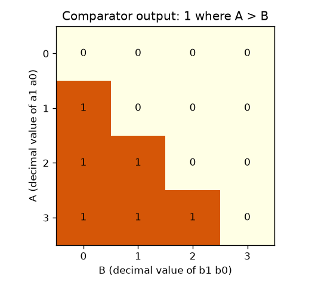
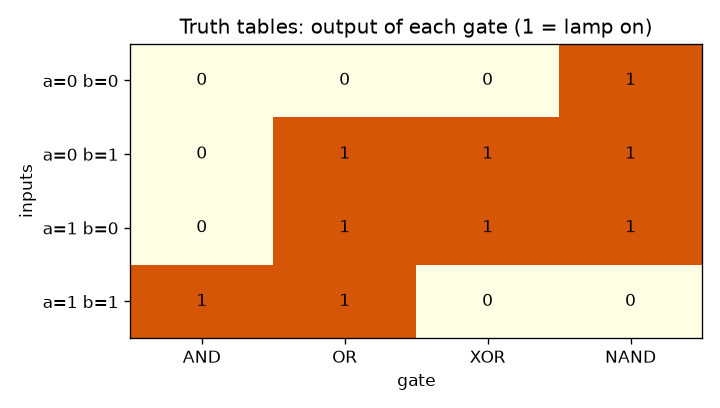

# Session 2: Number systems, logic gates and Boolean algebra

*Level 2 (mathematical engineering model) · about 75 minutes · openbinary*

> This is a simplified educational model. It is not a validated design tool and must not be used for real structures, electrical installations, vehicles, industrial processes or medical decisions.

**Prerequisites**

- Session 1: bits and place values.
- Python functions and lists (explained in PRIMER.md).

**Learning objectives.** After this session you can:

- Convert whole numbers between binary, decimal and hexadecimal, by hand and by a function you test on thousands of numbers.
- Write the truth tables of AND, OR, NOT, XOR and NAND.
- Verify De Morgan's laws by trying every input.
- Show that NAND alone can build NOT, AND, OR and XOR.
- Design a gate from a truth table using sum of products, and verify it on every input.

## A. Real-world problem
A stairwell light has a switch at the top and one at the bottom, and either one must toggle the light. A lift must not move unless the door is closed AND the load is within the limit. Rules like these are built from logic gates, tiny circuits whose output is 0 or 1 and depends only on their inputs. To talk about the numbers inside such machines, engineers also write them in hexadecimal, which is binary in a short form. This is a simplified educational model: ideal gates with no electrical detail.

## B. Concept and theory
In base b the digit string d_k ... d_1 d_0 means d_k b^k + ... + d_1 b + d_0. To convert a number to base b, divide by b again and again and collect the remainders, last remainder first. Hexadecimal (base 16) uses digits 0 to 9 and A to F (A is 10, F is 15), and each hex digit stands for exactly four bits, so 1011 0111 is B7. A logic gate maps input bits to an output bit. AND gives 1 only if both inputs are 1; OR gives 1 if at least one is 1; NOT flips a bit; XOR gives 1 if the inputs differ; NAND is NOT of AND. A truth table lists the output for every input row, and a claim that is true on every row is proved. De Morgan's laws turn an AND into an OR by flipping inputs and output. Because NAND(a, a) is NOT a, NAND can build NOT, then AND, then OR, then XOR: it is called universal. Any truth table can be turned into a circuit: write one AND term (a minterm) for each row whose output is 1 and OR the terms together (sum of products).

| Symbol | Meaning | Unit |
|---|---|---|
| b | the base of a number system (2, 10 or 16) | no unit |
| d_k | digit in place k | no unit |
| a, b | input bits of a gate | 0 or 1 |
| NOT a | the opposite bit of a (written with a bar in equations) | 0 or 1 |
| minterm | an AND term that is 1 on exactly one input row | 0 or 1 |

**Assumptions**

- Gates are ideal and instant (delay is added in Session 3).
- Only whole numbers are converted.
- Inputs are exactly 0 or 1.

$$ N=\sum_k d_k\,b^{k} $$

$$ \overline{a\cdot b}=\bar a+\bar b,\qquad \overline{a+b}=\bar a\cdot\bar b $$

$$ \bar a=\overline{a\cdot a},\qquad a\cdot b=\overline{\overline{a\cdot b}},\qquad a+b=\overline{\bar a\cdot\bar b} $$

$$ a\oplus b=a\bar b+\bar a b $$

$$ \text{majority}(a,b,c)=\bar a bc+a\bar b c+ab\bar c+abc=ab+ac+bc $$

## C. Visual explanation
The first figure is a grid of the truth tables of AND, OR, XOR and NAND: each column is a gate, each row an input pair, and a dark square means the lamp is on. Compare the columns: AND is on in one row, OR in three, XOR in two, and NAND is exactly the opposite of AND. The second figure is the 2-bit comparator: A runs down the side and B along the top, and a dark square means A > B. All six dark squares sit below the diagonal, because those are the pairs where the row number is larger than the column number.

*The 2-bit comparator: dark where A is greater than B.*

*Truth tables of AND, OR, XOR and NAND for the four input pairs.*

## D. Interactive simulation
Run the lesson (`python start.py 2`), then open the live app: [Session 2: gates and number systems](https://krunalpanchal1995.github.io/openbinary/session-02/) (or `app.html` in this folder). Pick a gate, flip inputs a and b and watch the output lamp; then open the truth-table view to see all four outputs. Move the number slider to see one number in binary, decimal and hexadecimal.

**Challenge.** Set the NAND gate with both inputs on, the only input pair for which NAND outputs 0.

## E. Worked example and experiment
**Problem.** Convert 183 to binary and to hexadecimal, and check by converting back.

1. Divide by 2 repeatedly and collect remainders from last to first. 183 = 128 + 32 + 16 + 4 + 2 + 1, so the bits are 1 0 1 1 0 1 1 1.
2. So 183 is 10110111 in binary.
3. Group in fours from the right: 1011 and 0111. 1011 is 11, which is B, and 0111 is 7.
4. So 183 is B7 in hexadecimal.
5. Check: B7 = 11 x 16 + 7 = 176 + 7 = 183. The same number.

**Answer.** 183 is 10110111 in binary and B7 in hexadecimal.

**Experiment.** Use a calculator or a programming language that shows a number in several bases (the Python functions bin() and hex() will do) and test five numbers of your own against your hand conversions. Then build AND and OR with a battery, a bulb and two switches: switches in series (one after the other) behave like AND, switches side by side behave like OR. Real switches and bulbs differ from the model: contacts have resistance, the bulb takes time to warm up, and a battery runs down. The truth table is exact only for ideal parts.

## F. Assessment and design challenge
**Question type A: Conceptual.** Why can NAND build every other gate? Show how to get NOT and OR from NAND.

Hint

What does NAND do when both inputs are the same wire? Then use De Morgan.

Step-by-step solution

NAND(a, a) is NOT(a AND a) = NOT a, so NAND gives NOT. AND is NOT of NAND, so AND takes two NAND gates. OR(a, b) = NOT(NOT a AND NOT b) = NAND(NOT a, NOT b), which takes three NAND gates. XOR takes four. With NOT and AND you can build any truth table, so NAND alone is enough.

**Question type B: Numerical.** Convert the hexadecimal number A5 to decimal and to binary, and convert decimal 100 to binary and hexadecimal. Sanity check.

Hint

A is 10. Each hex digit is four bits.

Step-by-step solution

A5 = 10 x 16 + 5 = 165, and A = 1010, 5 = 0101, so A5 is 10100101. For 100: 64 + 32 + 4 = 100, so it is 1100100 in binary; grouping 0110 0100 gives 64 in hexadecimal (6 x 16 + 4 = 100). Check: 10100101 = 128 + 32 + 4 + 1 = 165.

**Question type C: Graph and simulation interpretation.** In the comparator figure (A down the side, B along the top, dark where A > B), where are the dark squares and how many are there? Why is the diagonal white?

Hint

On the diagonal A and B are equal.

Step-by-step solution

There are six dark squares, all below the diagonal (the row number A is larger than the column number B): 3 + 2 + 1 = 6. The diagonal is white because there A = B, so A > B is false. The squares above the diagonal are white because there B is larger.

**Question type D: Design and optimisation challenge.** Design: a lock opens when the 2-bit number A equals the 2-bit number B. Build the truth table, write the sum-of-products form and give a shorter form with XNOR. How many minterms are there?

Hint

List the 16 rows (a1 a0 b1 b0) and mark those with A = B. XNOR is 1 when its inputs are the same.

Step-by-step solution

A = B on four rows: 0000, 0101, 1010, 1111, so there are 4 minterms out of 16. Sum of products: the OR of those four 4-input AND terms. Shorter: (a1 XNOR b1) AND (a0 XNOR b0), because A = B exactly when each bit pair matches. Trade-off: the sum of products is mechanical and always works, the short form uses fewer gates but needs insight. We checked both on all 16 rows.

Score yourself with [RUBRIC.md](../../RUBRIC.md). Print the [activity sheet](activity_sheet.md) to work on paper.

## Common misconceptions
| Common misconception | What is actually true |
|---|---|
| OR means exactly one of the two. | OR is 1 when at least one input is 1, including both. 'Exactly one' is XOR. |
| NAND is just a strange gate nobody uses. | NAND is universal: every other gate can be built from NAND alone, which is why chips use it so much. |
| Checking a few cases proves a Boolean law. | With few inputs you can check every row. A claim true on every row of the truth table is proved; a few cases out of many are not. |
| Hexadecimal is a different number from binary. | It is the same number in a shorter form: one hex digit is exactly four bits. |

## Glossary
- **hexadecimal**: base 16: digits 0 to 9 then A to F; one digit is four bits
- **logic gate**: a circuit whose output bit depends only on its input bits
- **truth table**: a list of the output for every possible combination of inputs
- **De Morgan's laws**: rules that swap AND and OR when you flip the inputs and the output
- **minterm**: an AND term that is 1 on exactly one row of the truth table
- **universal gate**: a gate from which every other gate can be built (NAND is one)

## Finish
1. Do the three coding tasks in [exercises.md](exercises.md).
2. Run `python start.py 2` again after your changes. It ends with the checkpoint; when it prints `PASS`, you are done. (Checkpoint only: `python start.py check 2`.)

Next: [Session 3](../session-03/README.md)
