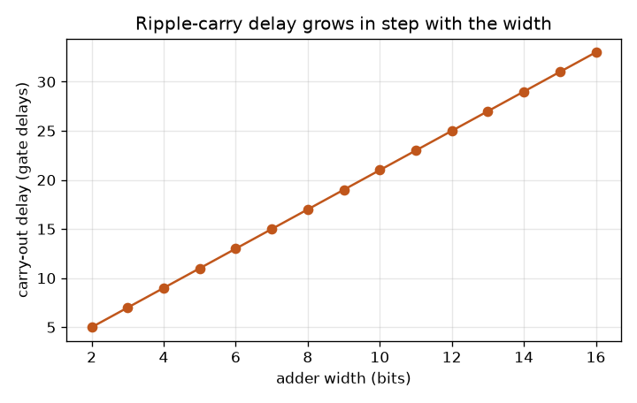
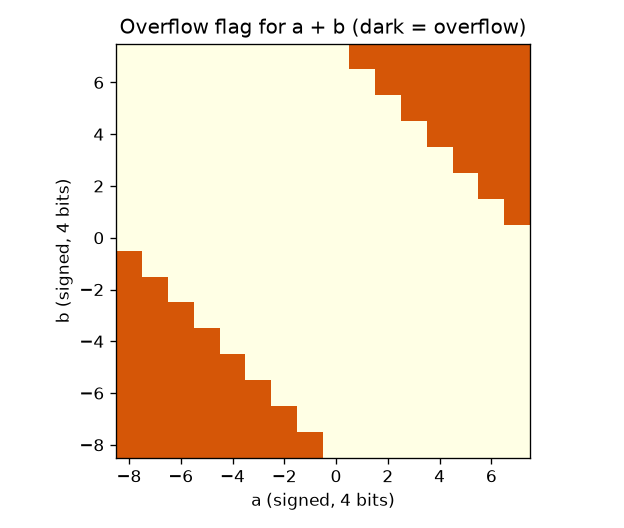

# Session 3: Build an adder from gates and see how computers count

*Level 3 (simulation and validation) · about 90 minutes · openbinary*

> This is a simplified educational model. It is not a validated design tool and must not be used for real structures, electrical installations, vehicles, industrial processes or medical decisions.

**Prerequisites**

- Session 1: bits and place values.
- Session 2: gates and truth tables.

**Learning objectives.** After this session you can:

- Build a half adder, a full adder and an n-bit ripple-carry adder in a small gate-level simulator.
- Represent negative numbers in two's complement and subtract with the same adder.
- Detect overflow, and explain why 7 + 1 gives -8 on four bits.
- Measure the gate delay of the carry chain and explain why it grows with the number of bits.
- Select add, subtract, AND or OR in a 4-bit ALU slice and validate it against Python for every input.

## A. Real-world problem
Inside a processor there is no plus button, only gates. Yet it adds very many numbers every second, subtracts, and knows when an answer does not fit. How can a handful of AND, OR and XOR gates add two numbers, and why does it take longer to add 32 bits than 4? We build the arithmetic of a computer from scratch in a tiny simulator and test every circuit against Python's own integers on every possible input. This is a simplified educational model: ideal gates, each with one unit of delay, no clock and no real chip timing.

## B. Concept and theory
A half adder adds two bits: the sum bit is a XOR b (1 when the inputs differ) and the carry bit is a AND b (1 when both are 1). A full adder also takes a carry in: sum = a XOR b XOR c_in and carry out = ab + (a XOR b) c_in; it is two half adders and an OR gate, five gates in all. Chain n full adders with the carry out of each feeding the next and you get an n-bit ripple-carry adder. In n-bit two's complement the leftmost bit counts as -2^(n-1) instead of +2^(n-1), so four bits cover -8 to 7 and 1111 means -1. To negate a number flip every bit and add 1, so a - b = a + (NOT b) + 1: XOR every b bit with a control bit `sub` and use `sub` as the carry in, and one adder both adds and subtracts. If the true answer is outside the range, the result wraps round and overflow occurs; it is detected when the carry into the top bit differs from the carry out of it. Each gate takes one unit of delay, and a wire's depth is one more than the depth of its slowest input. The carry out of stage i must wait for the carry out of stage i - 1, so the delay of the last carry grows in a straight line with the width. That is why fast processors use carry-lookahead circuits (a stretch topic) that work out carries in parallel. An ALU (arithmetic logic unit) feeds the same inputs to several operations and a control code selects which result comes out.

| Symbol | Meaning | Unit |
|---|---|---|
| a, b | input bits (or n-bit numbers) | 0 or 1 |
| c_in, c_out | carry into and out of a stage | 0 or 1 |
| n | adder width | bits |
| sub | control bit: 0 add, 1 subtract | 0 or 1 |
| T(n) | delay of the last carry out | gate delays |
| op | ALU control code: 00 add, 01 subtract, 10 AND, 11 OR | 2 bits |

**Assumptions**

- Every gate has the same delay of 1 unit; wires are free.
- Numbers have a fixed width n and wrap round when they do not fit.
- Signed numbers use two's complement.
- No clock or memory: the circuit is purely combinational.

$$ s=a\oplus b\oplus c_{in},\qquad c_{out}=ab+(a\oplus b)\,c_{in} $$

$$ \text{value}=-b_{n-1}2^{\,n-1}+\sum_{k=0}^{n-2}b_k 2^{k},\qquad -2^{n-1}\le \text{value}\le 2^{n-1}-1 $$

$$ a-b=a+\bar b+1\pmod{2^{n}} $$

$$ \text{overflow}=c_{n-1}\oplus c_{n} $$

$$ T(n)=2n+1\ \text{gate delays} $$

## C. Visual explanation
The first figure plots the carry-out delay of the ripple adder against its width, read from the simulator's depth counter. It is a straight line: each extra bit adds exactly two gate delays, giving 9 gate delays at 4 bits and 17 at 8 bits. The second figure is the overflow map for adding two 4-bit signed numbers: a runs along the bottom and b up the side, and dark squares show where the flag is raised. The dark squares are in two corners, where two large positive numbers (top right) or two large negative numbers (bottom left) are added; 64 of the 256 pairs overflow.

*Carry-out delay of the ripple adder grows in a straight line with its width.*

*Overflow flag for adding two 4-bit signed numbers: dark squares overflow.*

## D. Interactive simulation
Run the lesson (`python start.py 3`), then open the live app: [Session 3: a 4-bit ripple-carry adder-subtractor](https://krunalpanchal1995.github.io/openbinary/session-03/) (or `app.html` in this folder). Set a, b and the add/subtract control and watch the four full adders: the carry wires light up from right to left, the sum lamps show the result and the red lamp shows overflow. Open the delay view to see how the carry delay grows with width.

**Challenge.** Make the adder overflow: choose two numbers whose true sum is above 7 (add, not subtract).

## E. Worked example and experiment
**Problem.** Compute 6 - 3 on four bits with the adder-subtractor, showing the bits.

1. Subtraction means sub = 1: flip every bit of b and add 1 through the carry in.
2. 6 is 0110 and 3 is 0011; flipping the bits of 3 gives 1100.
3. Add 0110 + 1100 + 1 (the carry in) = 10011.
4. Keep only four bits: 0011, the carry out of the top bit is thrown away.
5. 0011 is 3, and 6 - 3 = 3. The carry into the top bit and the carry out of it are equal, so there is no overflow.

**Answer.** 6 - 3 = 3, pattern 0011, overflow flag 0.

**Experiment.** Use a four-digit calculator or a car odometer to see wrap-around: set 9999 and add 1. The count rolls to 0000 just as 4-bit 1111 + 1 rolls to 0000. Real adders differ from the model: gate delays are not all equal, wires add delay, and real chips make carries fast with lookahead circuits. The model counts delay in whole gate steps and ignores the clock.

## Real-world application and mini-project: Build and test an 8-bit adder-subtractor
A small calculator chip needs to add and subtract 8-bit numbers (-128 to 127) and to warn when the answer does not fit. Use `build_add_sub(8)` and `add_sub` from Session 3. Test it on every pair of inputs for both operations against Python integers, count the pairs that overflow, count its gates, read the delay of its overflow flag, and then decide the widest adder-subtractor whose overflow flag is ready within a 10 ns budget if one gate takes 0.5 ns.

**Deliverable:** A script that checks all 65536 input pairs for add and for subtract against Python, prints the number of overflow cases for each, the number of gates, the delay of the overflow flag in gate delays, and the widest width that meets the budget, and saves a picture of the overflow map for adding.

**Success looks like:** Every one of the 65536 pairs matches Python for both operations, 16384 pairs overflow for add and 16384 for subtract, the circuit has 49 gates, the overflow flag is ready after 19 gate delays, and the widest width within 10 ns is 8 bits (a 9-bit version needs 21 gate delays, 10.5 ns).

## F. Assessment and design challenge
**Question type A: Conceptual.** Why does 7 + 1 give -8 on four bits, and how does the circuit know that the answer is wrong?

Hint

Write 0111 + 0001, and compare the carry into the top bit with the carry out of it.

Step-by-step solution

0111 + 0001 = 1000. Read as two's complement, 1000 is -8, because the top bit has the weight -8. The true answer 8 does not fit in -8 to 7, so the result wrapped round. The carry into the top bit is 1 but the carry out of it is 0; they differ, so the overflow flag is 1.

**Question type B: Numerical.** Compute 5 - 7 on four bits: show the three numbers you add, the four-bit result, and whether overflow occurs. Sanity check with ordinary arithmetic.

Hint

Flip the bits of 7 (0111), add 0101 and add the carry in 1.

Step-by-step solution

NOT 0111 = 1000. Add 0101 + 1000 + 1 = 1110 (14). Read as two's complement, 1110 is 14 - 16 = -2. Check: 5 - 7 = -2, and -2 is inside -8 to 7, so overflow is 0.

**Question type C: Graph and simulation interpretation.** From the delay graph, how many gate delays does the carry take for 8 bits, and for 12 bits? What does the slope of the line tell you?

Hint

The line is T(n) = 2n + 1.

Step-by-step solution

For 8 bits T = 17 gate delays; for 12 bits T = 2 x 12 + 1 = 25. The slope is 2 gate delays per extra bit, the two gates (AND then OR) that the carry passes through in every stage. Doubling the width roughly doubles the delay, which is the reason for carry-lookahead.

**Question type D: Design and optimisation challenge.** Design: each gate takes 0.5 ns and the carry out of a ripple adder must be ready within 20 ns. What is the widest adder allowed? What would you change to go wider?

Hint

Solve (2n + 1) x 0.5 <= 20.

Step-by-step solution

(2n + 1) x 0.5 <= 20 gives 2n + 1 <= 40, so n <= 19.5 and the widest is 19 bits (39 gate delays = 19.5 ns; 20 bits would need 41 gate delays = 20.5 ns). To go wider, use a carry-lookahead adder, or split the work over two clock cycles. Trade-off: lookahead needs more gates for less delay.

Score yourself with [RUBRIC.md](../../RUBRIC.md). Print the [activity sheet](activity_sheet.md) to work on paper.

## Common misconceptions
| Common misconception | What is actually true |
|---|---|
| Overflow means the carry out of the top bit is 1. | For unsigned numbers yes, but for signed numbers overflow is when the carry into the top bit differs from the carry out of it. -1 + 1 has a carry out of the top bit and no overflow. |
| Subtraction needs a separate subtractor circuit. | Flip the bits of b and use a carry in of 1: the same adder subtracts. |
| The 4-bit answer 7 + 1 = -8 is a bug in the adder. | The adder is right modulo 16; the result is a wrapped value, and the overflow flag says that the true answer did not fit. |
| A bigger adder is just as fast as a small one. | A ripple-carry adder is slower in direct proportion to the width, because each carry waits for the one before it. |

## Glossary
- **half adder**: adds two bits; sum is XOR, carry is AND
- **full adder**: adds two bits and a carry in; two half adders and an OR
- **ripple-carry adder**: full adders in a chain, each carry feeding the next stage
- **two's complement**: a way to write negative numbers: the top bit has a negative weight
- **overflow**: the true answer does not fit in the number of bits, so the result wraps
- **gate delay**: the time unit for one gate to respond; here 1 for every gate
- **ALU**: arithmetic logic unit: a circuit that does several operations chosen by a control code
- **carry-lookahead**: a faster adder that works out carries in parallel (stretch)

## Finish
1. Do the three coding tasks in [exercises.md](exercises.md).
2. Run `python start.py 3` again after your changes. It ends with the checkpoint; when it prints `PASS`, you are done. (Checkpoint only: `python start.py check 3`.)

Next: the [roadmap](../../promo/roadmap.md). Session 4 is yours to build.
